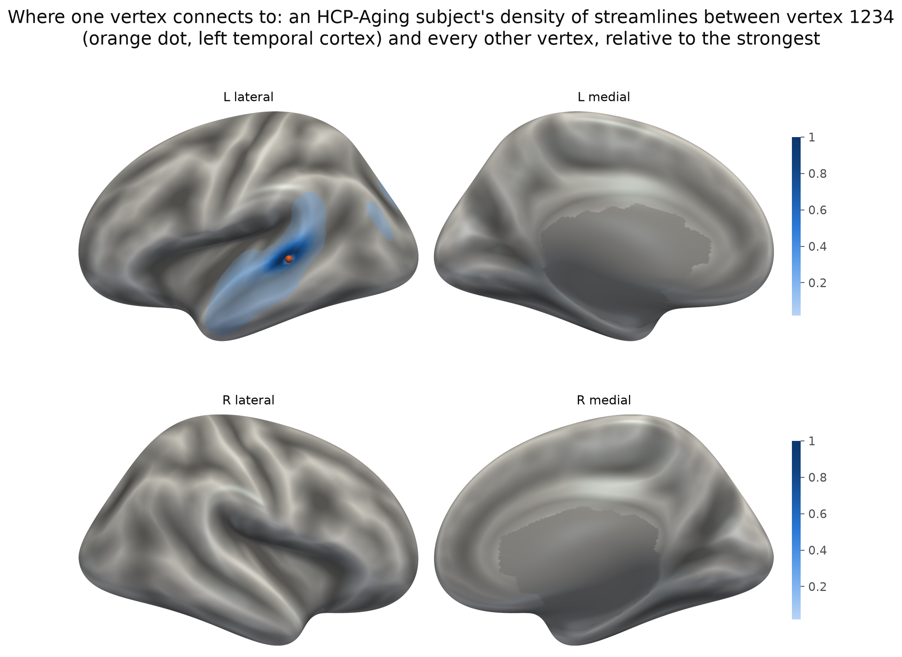

# sbci

[](https://github.com/xya2001/SBCI/actions/workflows/tests.yml)

Continuous brain connectivity in Python: read, parcellate, smooth, couple,
align and reduce surface-based connectomes on the ico4 grid, with every method
a port of the SBCI group's MATLAB, checked against the reference and, where the
reference itself is wrong, corrected (PORTING.md).

SBCI, Surface-Based Connectivity Integration (Cole et al., *Human Brain
Mapping*, 2021), represents structural and functional connectivity as
continuous functions on the cortical surface instead of between atlas regions.
The ico4 grid is the icosahedron subdivided four times, FreeSurfer's
fsaverage4: 2,562 vertices per hemisphere, 5,124 in all, left then right. A connectome is a
5,124 × 5,124 matrix over that grid, stored in one HDF5 file per subject.

**Status: pre-alpha.** Every method below is implemented and verified against
its reference, and the connectomes of 946 HCP Young Adult subjects are
published on UNC Dataverse, any of them one command away.

## Install

Python 3.10 or newer. The package is not on PyPI yet, so install from GitHub:

```bash
pip install "sbci @ git+https://github.com/xya2001/SBCI.git"             # core: numpy, scipy, h5py, nibabel
pip install "sbci[plotting] @ git+https://github.com/xya2001/SBCI.git"   # + matplotlib and nilearn, for figures
pip install "sbci[render] @ git+https://github.com/xya2001/SBCI.git"     # + PyVista, for the smoothly lit figures
pip install "sbci[gpu] @ git+https://github.com/xya2001/SBCI.git"        # + CuPy, to align on a CUDA GPU
```

On UNC's Longleaf cluster, `scripts/setup_longleaf.sh` builds the environment
(USAGE.md, *Setup on Longleaf*).

## Quick start

One real subject is 90 MB away, on UNC Dataverse. The data come under the
HCP's [Open Access Data Use Terms](https://www.humanconnectome.org/study/hcp-young-adult/document/wu-minn-hcp-consortium-open-access-data-use-terms),
which a machine accepts once; the package fetches the subject, verifies it,
and writes the terms beside it:

```python
import sbci
from sbci.download import fetch_cohort

sc_path, fc_path = fetch_cohort(out="hcp-ya", subjects=["100307"], accept_terms=True)   # once; verified
sc = sbci.load(sc_path)                  # structural connectome, with the endpoints of its 803,741 streamlines
fc = sbci.load(fc_path)                  # functional connectome, from the HCP's resting state
sc.to_atlas("Schaefer200").shape        # (200, 200)
sc.plot(sc.seed(vertex=1234))            # a figure; needs the plotting extra
sc.coupling(fc)                          # structure against function, one value per vertex
sbci.save_map(sc.seed(vertex=1234), "seed.dscalar.nii")   # for Workbench; .func.gii for FreeSurfer, .csv for a table
sc.smooth(kernel="shk", mask_medial_wall=True)     # re-smooths from the stored endpoints
```

Or from the shell:

```bash
sbci download hcp-ya --subject 100307   # sub-100307_sc.h5 and _fc.h5, 90 MB; the first asks you to accept the terms
sbci info sub-100307_sc.h5              # what it holds
sbci validate sub-100307_sc.h5          # thirteen checks, all should pass
sbci atlases --match Yeo                # the bundled atlases
```

Without network access, `sbci example` writes a synthetic connectome on the
real grid to try the calls on; nothing in the documents is drawn from it.



*`sc.plot(sc.seed(vertex=1234), mesh="fsaverage", engine="pyvista")`: where
one vertex of sub-100307 connects to. The value at each vertex is the density
of streamlines between the seed (orange dot, left temporal cortex) and that
vertex, relative to the strongest.*

## What it does

| | Call | Verified against |
| --- | --- | --- |
| Load and save | `sbci.load(path)`, `cc.save(path)` | the format's own checks (`sbci validate`) |
| A cohort | `sbci.load_cohort(folder, table=..., modalities=("sc", "fc"))`, `sbci cohort`: files matched to a subject table, SC paired with FC, settings checked, a report of who is left out and why | the 946 young adults: 943 in, the 3 without a fluid-intelligence score out |
| Parcellate | `cc.to_atlas("Schaefer200")`, 44 atlases bundled | `parcellate_sc.m`, to float64 rounding |
| Seed profile | `cc.seed(vertex=...)`, `cc.seed(region=...)` | the MATLAB seed rows, to float32 rounding (the file stores the connectome in float32) |
| Structure-function coupling | `sc.coupling(fc, scope=...)`, three forms | the three MATLAB functions, to float64 rounding |
| Smoothing | `cc.smooth(kernel="shk" \| "rdk" \| "matern")` from the stored endpoints; `rdk` and `matern` fetch the grid's Laplace-Beltrami basis, 100 MB, the first time | `concon` at r = 1.000000 at full scale, but for the one vertex it never writes; MATLAB to 3.14 float32-eps; the Matern closed form |
| Alignment | `sbci.align(subjects)` (ENCORE, on densities), `sbci.endpoints_align(subjects)` (ConSEAL, on endpoints), for `subjects = [sbci.load(p) for p in cohort.paths("sc")]`; `template=fixed` registers onto one subject; `device="gpu"` runs either on a CUDA GPU | the MATLAB references stage by stage, with the references' own errors put back for the comparison: ENCORE's geometry, template and composition to float64 rounding, what follows its reference's 1e-10 finite difference within that difference's own instability (5e-4 to 7e-4), ConSEAL to its reference's single precision; the references' shared errors are corrected and checked against closed forms (PORTING.md items 8, 9, 21 and 22); on a GPU, every step the CPU's to rounding and a registration within the CPU's own spread, 12 to 17 times faster on a V100 (PORTING.md item 26) |
| Carrying a warp | `sbci.migrate_warp(warp, to="fs_LR_32k")` | an identity and a known rotation |
| Reduction | `sbci.reduce(cohort.paths("sc"), rank=K)` (functional PCA, one file at a time); `sbci.project(fit, held_out)` scores new subjects on its basis | the MATLAB reference run to its fixed point, to 1e-15 on every component (at its default tolerance the first vector to 2.3e-16, since the port scores the vector it returns, PORTING.md item 17); `project` scores as the fit itself does, not by the reference's lower-triangle fit (PORTING.md items 8 and 21) |
| Inference | `sbci.local_test(scores, design, groups=...)`, on components or per-vertex features; `sbci.stats.design(...)` for named covariates and factors, `terms=["site"]` and `contrast=` for the hypothesis; estimates with standard errors, intervals and partial R-squared | `scipy.stats` and statsmodels (no MATLAB reference exists), to 1e-9 |
| Test-retest | `sbci.stats.icc(sessions)`, ICC(2,1) or (3,1) for every feature; `sbci.stats.identification(first, second)`, connectome fingerprinting; `endpoints.take(...)` to split a subject's streamlines | Shrout and Fleiss's published example; `np.corrcoef` in float64 |
| Figures | `cc.plot(values, mesh="fsaverage", engine="pyvista")` | drawn on FreeSurfer's fsaverage, shaded by sulcal depth |
| Exchange | `cc.to_cifti(path)`: a 16.9 GB fsLR-32k dense connectome for Connectome Workbench | mass conserved to 1.1e-10; Workbench reads it |
| Export | `sbci.save_map(values, "map.dscalar.nii" \| "map.func.gii" \| "map.csv")` for per-vertex maps; `sbci.region_means(values, atlas)` and `sbci.save_regions(...)` for labelled region tables; `result.to_table(path)` for a test | FreeSurfer 7.4.1 and Workbench 1.5.0 read the files back: the GIFTI is in FreeSurfer's fsaverage4 order (r = 1.0000 after `mri_surf2surf`), the fsLR map keeps the area-weighted mean when written whole |
| Data | `sbci download hcp-ya`: any of the 946 young adults, from UNC Dataverse | SHA-256 of every file |

[PORTING.md](PORTING.md) records how each port was verified and what was found
in the references; [docs/RESULTS.md](docs/RESULTS.md) shows what the methods
do on the released subjects.

## The data

The structural and functional connectomes of 946 HCP Young Adult subjects are
published on UNC Dataverse, <https://doi.org/10.15139/S3/NDAJYX>. Each subject
has a structural connectome (SC, with its streamline endpoints) and a
functional one (FC, from the HCP's own cleaned resting-state runs placed on the
grid through the subject's registration), 85 GB in all, in 40 tar archives of
at most 50 subjects. The package fetches any of them by subject, about 90 MB each,
without downloading the rest of its archive:

```bash
sbci download hcp-ya --out hcp-ya            # the tutorial's eleven subjects, about 1 GB
sbci download hcp-ya --subject 100307        # one subject, any of the 946
sbci download hcp-ya --all --out hcp-ya-full # all 946, 85 GB
sbci download hcp-ya --list                  # their ids, sex, age band and size; nothing fetched
```

The data are the WU-Minn Human Connectome Project's, redistributed under its
[Open Access Data Use Terms](https://www.humanconnectome.org/study/hcp-young-adult/document/wu-minn-hcp-consortium-open-access-data-use-terms).
The first download on a machine shows them and asks you to type "I agree"
(`--accept-terms` in a script, `accept_terms=True` in Python, having read
them), and every download writes `DATA_USE.txt` beside the files, with the
acknowledgment a publication must carry and the dataset's citation.
`manifest.csv` beside them gives each subject's sex and HCP age band, never an
exact age. [docs/RESULTS.md](docs/RESULTS.md) analyses all 946;
`tools/build_hcp_cohort.py` and `tools/build_hcp_fc.py` build the files from
the HCP's own data, and `tools/import_legacy.py` converts existing pipeline
output (USAGE.md, *Getting the data* and *Using legacy pipeline output*).

## Documentation

| Read | For |
| --- | --- |
| [USAGE.md](USAGE.md) | every function with a worked example on the released subjects, and what the common errors tell you |
| [docs/RESULTS.md](docs/RESULTS.md) | what the methods do on real data: the figures, and the analysis of the 946 young adults |
| [notebooks/](notebooks/README.md) | the paper's three worked examples -- one subject explored, structure against function in the eleven, a cohort analysis of 943 -- and two analyses of young adults, saved with their outputs: how far a continuous connectome repeats, across days and across halves of its streamlines, and prediction with every fit inside the training folds |
| [PORTING.md](PORTING.md) | how each of the seven MATLAB methods was ported and verified, and the errors found in the references |
| [VERIFICATION.md](VERIFICATION.md) | how to check every claim yourself, in tiers from five minutes to a MATLAB licence |
| [docs/review-2026-10-05.md](docs/review-2026-10-05.md) | the independent reviews of October 2026, of the implementation and then of the notebooks: what they found, which errors were the MATLAB references' own, and what was done about each |
| [SPEC_QUESTIONS.md](SPEC_QUESTIONS.md) | the file-format decisions, answered and open |
| [BLUEPRINT.md](BLUEPRINT.md) | what the package is, what "finished" means, and the decisions it waits on |
| [scripts/](scripts/README.md), [tools/](tools/README.md), [docs/figures/](docs/figures/README.md) | worked scripts (with the lab's Longleaf paths), the builders of the bundled data, and the figures |

## Development

```bash
git clone https://github.com/xya2001/SBCI.git && cd SBCI
pip install -e ".[dev]"
pytest                                   # about ten minutes on eight cores; 74 skip (below)
ruff check src tests scripts tools && ruff format --check src tests scripts tools
```

Of the 74 tests that skip, 26 need data outside the repository (23 against
the MATLAB references, three of the five-minute start), 34 need CuPy and a
CUDA GPU (`tests/test_gpu.py`, VERIFICATION.md's Tier 3), 13 are doctest
examples marked `+SKIP`, and one is the slow planted-answer test,
`SBCI_SLOW_TESTS=1`. CI's test matrix installs the plotting extra without the
render one, so the PyVista view in `tests/test_render.py` skips there as well:
75.

CI runs the suite on Linux and macOS, Python 3.10 and 3.13; builds the wheel
and installs it in a blank environment; runs the brief's acceptance lines and
the quick start's smoothing on sub-100307, downloaded from UNC Dataverse;
and runs the rendering tests and the slow planted-answer test under a virtual
display. On Longleaf,
`sbatch scripts/test.sbatch` runs the suite as a batch job, and
`SBCI_HCP_DIR=hcp-ya sbatch --export=ALL scripts/test.sbatch` adds the tests
on the released subject. [VERIFICATION.md](VERIFICATION.md) lists what each
check proves.

## References

The methods implemented here, and the paper each one ports:

- **SBCI** — Cole, M., Murray, K., St-Onge, E., Risk, B., Zhong, J., Schifitto, G.,
  Descoteaux, M., & Zhang, Z. (2021). Surface-Based Connectivity Integration: An
  atlas-free approach to jointly study functional and structural connectivity.
  *Human Brain Mapping*, 42(11), 3481–3499. <https://doi.org/10.1002/hbm.25447>
- **ENCORE** — Cole, M. R., Xiang, Y., Consagra, W., Srivastava, A., Qiu, X., & Zhang, Z.
  (2026). ENCORE: Fast geometric framework for aligning brain structural connectivity
  on cortical manifolds. *Medical Image Analysis*, 114, 104242.
  <https://doi.org/10.1016/j.media.2026.104242>
- **ConSEAL** — Xiang, Y., Cole, M., & Zhang, Z. (2026). ConSEAL: Connectivity-informed
  streamline endpoint alignment for diffeomorphic cortical registration. *arXiv*,
  2605.16742. <https://arxiv.org/abs/2605.16742>
- **FPCA** — Consagra, W., Cole, M., Qiu, X., & Zhang, Z. (2024). Continuous and
  atlas-free analysis of brain structural connectivity. *Annals of Applied
  Statistics*, 18(3), 1815–1839. <https://doi.org/10.1214/23-AOAS1858>
- **Riemannian diffusion kernel** — Wang, L., Li, D., & Zhang, Z. (2025). Riemannian
  diffusion kernel-smoothed continuous structural connectivity on cortical surface.
  *Imaging Neuroscience*, 3, IMAG.a.912. <https://doi.org/10.1162/imag.a.912>

The data:

- **The 946 connectomes** — Zhang, Z., & Xiang, Y. (2026). Continuous structural and
  functional connectomes of 946 HCP Young Adult subjects on the fsaverage ico4 cortical
  grid (Version 1) [Data set]. UNC Dataverse. <https://doi.org/10.15139/S3/NDAJYX>

## License

The code: MIT -- see [LICENSE](LICENSE). The data on UNC Dataverse come under the
WU-Minn HCP Consortium Open Access Data Use Terms instead.
