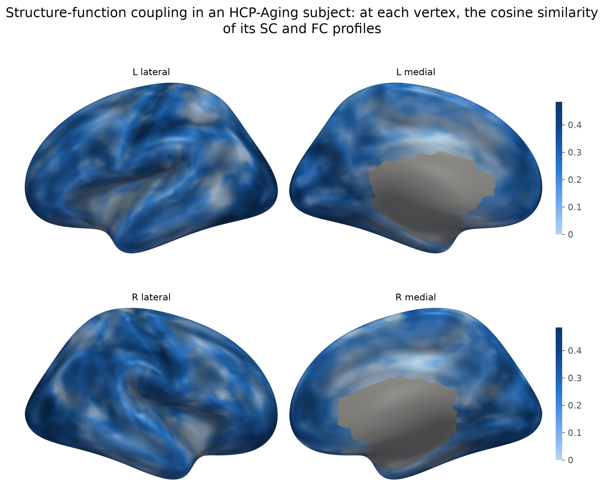
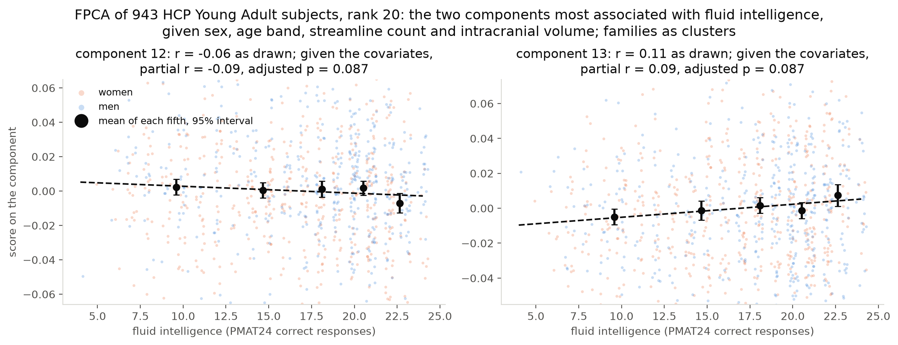
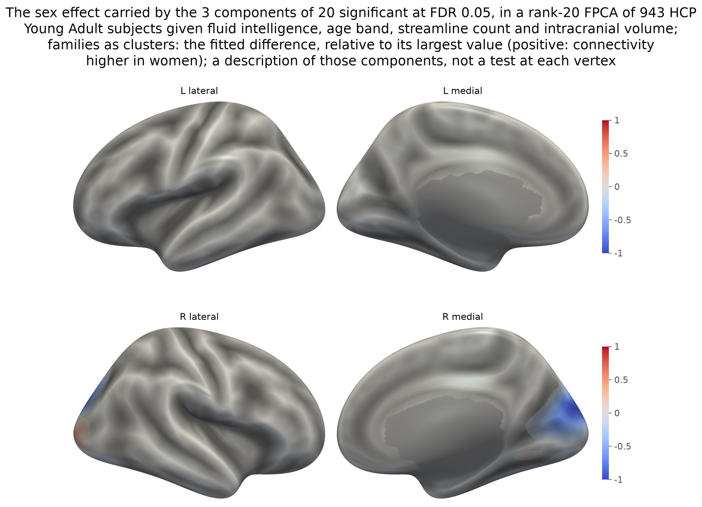
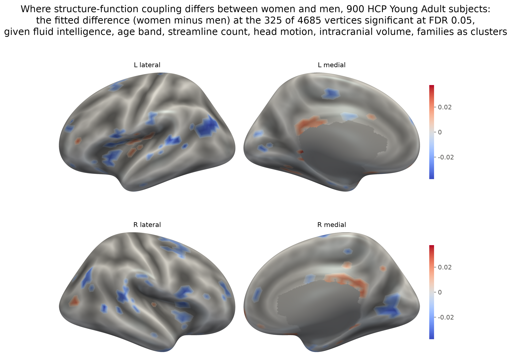
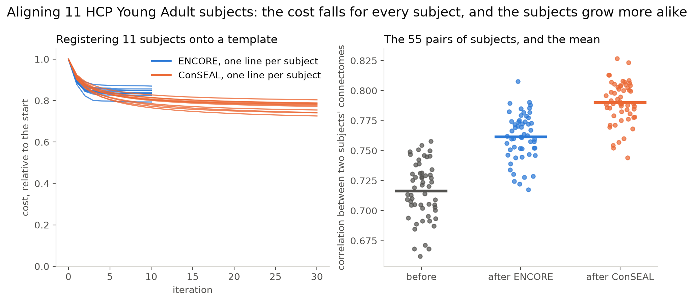

# Results on the released subjects

What the methods do on real data: the figures the package's documents show,
with the measurements behind them. Everything here is drawn from the eleven
HCP Young Adult subjects of the example cohort (`sbci download hcp-ya`) or,
for the cohort analyses, from all 946 young adults with complete pipeline
output, which UNC Dataverse publishes (`sbci download hcp-ya --all --out hcp-ya-full`). [USAGE.md](../USAGE.md) shows the calls
behind each figure as worked examples, [PORTING.md](../PORTING.md) records
the measurements, and [figures/README.md](figures/README.md) says how to
regenerate every figure.

No subject is named here by its HCP id. The cohort analyses use the HCP's
restricted table of families, and the HCP's terms allow no subject id in a
public report of an analysis that uses restricted data; the single-subject
figures show one of the eleven, called here the tutorial subject.

## The data behind the figures

The figures are drawn from the eleven young adults of the
example cohort, 22 to 35 years old by the HCP's open-access age bands, and the
single-subject figures from the tutorial subject. All
were rebuilt on the ico4 grid from the lab's pipeline output with
`tools/build_hcp_cohort.py`, their FC from the HCP's resting state with
`tools/build_hcp_fc.py`, and drawn on FreeSurfer's fsaverage surface, rendered with smooth lighting
through PyVista (`plot(mesh="fsaverage", engine="pyvista")`);
`scripts/hcp_figures.py` draws them from a downloaded copy, and
[figures/README.md](figures/README.md) describes each.
The analysis of a whole cohort uses all 946 young adults with complete
pipeline output.

## One subject


*`sc.plot(sc.seed(vertex=1234), mesh="fsaverage", engine="pyvista")`: where one vertex of one
subject connects to. The value at each vertex is the density of streamlines
between the seed (the orange dot, left temporal cortex) and that vertex,
relative to the strongest, on the inflated surface shaded by sulcal depth.*

**What smoothing does.** Tractography gives endpoints. The tutorial subject's 803,741
streamlines were split into two random halves; 32 of them touch vertex 1234
in one half and 26 in the other. That is few: more streamlines end at 85% of
this subject's cortical vertices. So the two halves' raw counts share little,
and they agree across the cortex at only r = 0.41. Smoothed, they agree at
r = 0.99, where the same vertex in the other ten subjects agrees with this
one's at r = 0.54 to 0.80. The kernel pools the streamlines that end near the
vertex, and that is what makes two subjects, or two sessions, comparable
vertex by vertex.


*Top: the far ends of the streamlines that touch the vertex (blue dots), in
the two halves and in the whole set. Bottom: the smoothed density of the same
vertex from each, relative to its strongest vertex.*

**Structure against function.** `sc.coupling(fc)` asks, vertex by vertex, how
closely the cortex a vertex is wired to matches the cortex its activity moves
with: the cosine similarity of its SC and FC profiles. Averaged over the
eleven, coupling is highest in visual cortex (0.36 to 0.41 in the
pericalcarine, cuneus and lateral occipital regions) and lowest in the
cingulate and entorhinal cortex (0.05 to 0.09). It averages 0.30 over primary
and unimodal sensory and motor regions and 0.19 over association regions, the
gradient from sensory to transmodal cortex that coupling is known for
(Vázquez-Rodríguez et al., PNAS 2019; Baum et al., PNAS 2020), though those
studies measure coupling differently and in other samples, so only the
ordering compares. The entorhinal cortex is also where a vertex's FC strength
repeats least from one day to the next (`notebooks/reliability.ipynb`), so part
of its low coupling may be noise. The eleven subjects' maps correlate at
r = 0.53 to 0.71.



*`sc.coupling(fc)` for each of the eleven young adults, averaged: at each
vertex, the cosine similarity of its SC and FC profiles, coloured from the
map's 2nd to 98th percentile. The medial wall, which has no cortex, is gray.*

## A cohort: fluid intelligence and sex

The single-subject methods need one subject; the cohort methods need a
cohort. The example subjects are enough to align (below), but not to ask a
question of: an association among eleven people is out of reach. The analysis
here uses all 946 HCP Young Adult subjects with complete pipeline output in
the lab's copy, rebuilt on the ico4 grid as the example subjects were. All
946 are published on UNC Dataverse (`sbci download hcp-ya --all --out hcp-ya-full`), and
`tools/build_hcp_cohort.py` builds them from the pipeline's output for anyone
with HCP access. The
question is whether fluid intelligence, the number of Penn Matrix Test items
a subject answered correctly (`PMAT24_A_CR` in the HCP's open-access table),
shows in the structural connectome, with sex, age band, the streamline count
and head size in the model. Head size differs between the sexes, and both
the measures here and the tractography behind them change with it, so it
belongs in any comparison of women and men. The young adults are not
independent: the 946 come from 423 families of twins and siblings, and a test
that counts them as independent makes every p-value too small. `groups=` treats the families as
clusters. Family membership is in the HCP's restricted table, which has its
own data use agreement: it is read at analysis time, and only counts drawn
from it appear here, with no subject named beside them.

```python
import csv
from pathlib import Path
import numpy as np
import sbci

table = {f"sub-{r['Subject']}": r for r in csv.DictReader(open("unrestricted.csv"))}  # the HCP's open-access table
family = {f"sub-{r['Subject']}": r["Family_ID"] for r in csv.DictReader(open("RESTRICTED.csv"))}  # restricted
subjects = [p.name.split("_")[0] for p in sorted(Path("hcp-ya-full").glob("sub-*_sc.h5"))]
subjects = [s for s in subjects if table[s]["PMAT24_A_CR"]]    # those with a score
paths = [f"hcp-ya-full/{s}_sc.h5" for s in subjects]
reduction = sbci.reduce(paths, rank=20)                   # FPCA, one file at a time: a batch job, 230 GB
rows = [table[s] for s in subjects]
score = np.array([float(r["PMAT24_A_CR"]) for r in rows])
female = np.array([r["Gender"] == "F" for r in rows], dtype=float)
band = np.array([{"22-25": 23.5, "26-30": 28, "31-35": 33, "36+": 37}[r["Age"]] for r in rows])
count = np.array([sbci.load(p).metadata["streamline_count"] for p in paths]) / 1e6
volume = ...   # per subject: EstimatedTotalIntraCranialVol from T1w/<id>/stats/aseg.stats (litres)
design = np.column_stack([score, female, band, count, volume])   # local_test adds the intercept
groups = [family[s] for s in subjects]
trait = sbci.local_test(reduction.scores, design, terms=[1], groups=groups)   # fluid intelligence
trait.significant()                                       # the components that survive: none
sex = sbci.local_test(reduction.scores, design, terms=[2], groups=groups)     # sex, the trait as nuisance
effect = sex.effect_map(reduction, alpha=0.05)            # one value per vertex, surviving components only
sbci.load(paths[0]).plot(effect, mesh="fsaverage", engine="pyvista")
```

Fluid intelligence shows in neither the components nor the vertices of the 943
once the model holds the covariates. Streamed once, before any fit
(`tools/age_probe.py`), the 943 subjects with a score show it in the
connectivity strength of 113 of 4,685 cortical vertices at FDR 0.05, never
beyond |r| = 0.17, and in no Desikan region pair; but that test holds the
score alone. With sex, age band and streamline count in the model, 26
vertices remain, and with intracranial volume as well, none (partial
R-squared at most 0.019). Fit at rank 20, which captures 27% of the cohort's
norm (about 7% of its sum of squares), no component tracks it after the
false-discovery-rate correction across the twenty: the closest, components
12, 13 and 7, all sit at adjusted p 0.087, component 13 correlating with the
score at r = 0.11 before adjustment. Components are counted from 1 here, as in
USAGE.md and the figures; the code counts from 0, as `trait.significant()` and
`trait.to_table()` do, so component 13 is column 12 of `reduction.scores`.
Counted as 943 independent subjects, component 13 would sit at 0.061, and the
vertices of the test of the score alone at 217 rather than 113; before head
size was in the model, the families were the difference between a component
that passed (0.024) and none (0.064). A rank-4 fit comes nowhere near
(smallest adjusted p 0.28). The components' verdict lies near the threshold,
though: among the 913 with a resting-state measure of head motion, on the same
fit, one component passes (adjusted p 0.046), and with motion in the model
none does (0.062). Head size, which correlates with the score at r = 0.25,
changes little at the components: without it in the model the closest was
component 13 at 0.064.

Sex, tested in the same model with fluid intelligence as a nuisance, shows in
3 of the 20 components (3, 5 and 8, each at adjusted p 0.035), and in one of
a rank-4 fit. Head size carries much of the difference between women and men:
intracranial volume averages 1.71 L in men and 1.47 L in women, and without it
in the model sex shows in 13 components, the strongest at adjusted p 1e-7, and
in all four of a rank-4 fit. The three sit at the edge of the threshold: with
the logarithm of the volume in the model, five components pass (smallest
adjusted p 0.026); leaving out the twelve subjects whose FreeSurfer volume
lies beyond three standard deviations of their sex's mean, eleven of them
below it, none does (0.07); and among the 913 with a measure of head motion,
four pass, five with motion in the model.

Vertex by vertex the difference is firmer, and it lies elsewhere than the
components' effect map suggests. In connectivity strength, with the other four
covariates in the model, sex shows at 433 vertices: 440 with the logarithm of
the volume, 420 without the twelve, 402 among the 913 with motion in the model,
855 without head size, and 1,020 tested alone, as `tools/age_probe.py` tests
it, with 761 Desikan pairs. Of the 433, 327 have connectivity higher in women;
they split evenly between the hemispheres (214 left, 219 right), and the
largest share lies in the insula (57 vertices on the right, 33 on the left),
followed by the left superior frontal and fusiform cortex (21 each). It is not
head size left over. In 187 women and 187 men matched on intracranial volume,
186 vertices still differ, every one of the 433 keeps its sign, and the effects
grow: their partial correlations reach a median magnitude of 0.155, against
0.101 to 0.134 in unmatched samples of the same size. With head size as a
cubic, 411 differ.
Without streamline count in the model, 485 differ, 297 of them higher in women.
Tested on the 68 Desikan-Killiany regions instead, each region's strength the
area-weighted mean of its vertices', sex shows in 15 regions, the right insula
the strongest, and misses the vertices' differences in 16 others, among them
the left fusiform's 21 (PORTING.md item 34).

The effect map below shows something narrower: the fitted difference carried
by the three components that pass. Over the three it peaks in the right
cuneus, where connectivity is relatively higher in men; the right
pericalcarine cortex follows, a smaller patch near the right occipital pole is
higher in women, and the left hemisphere shows nothing above a twentieth of
the peak. Without head size the map spread over both occipital poles, the left
lateral occipital cortex among them, but that compares thirteen components
with three. The fitted difference over all twenty components keeps its shape
across the three versions of the model (r of 0.99 or more), with its peak in
the right cuneus; that is to be expected of three fits to nearly the same
subjects, and it says where the components put the difference, not where women
and men differ. PORTING.md items 5, 32 and 33 have the measurements.



*The two components of a rank-20 FPCA of 943 HCP Young Adult subjects most
associated with fluid intelligence, given sex, age band, streamline count and
intracranial volume, with families as clusters: each subject's score against
the number of PMAT24 items answered correctly (women orange, men blue), the
mean in each fifth of
that range with its 95% interval, and the least-squares line, all unadjusted;
each title gives the unadjusted r and, from the test, the partial r given the
covariates and the adjusted p-value. Neither survives the correction.*



*The effect map over the 3 components that track sex given fluid
intelligence, age band, streamline count and intracranial volume, families as
clusters, relative to its largest value: the fitted difference in connectivity
between women and men (positive: higher in women), summed over the other
endpoint. It describes those components: the test at each vertex finds sex at
433 vertices, most of them higher in women and the most in the insula.*

**Coupling across the cohort.** With FC built for the young adults
(`tools/build_hcp_fc.py`), each of the 903 with four complete resting-state
runs gives a coupling map, and `local_test` takes the 4,685 cortical vertices
as its columns: one test per vertex, families as clusters, with head motion
and intracranial volume added to the model because both shape these measures.

```python
motion = ...   # per subject: Movement_RelativeRMS_mean.txt averaged over the four runs (mm)
volume = ...   # per subject: EstimatedTotalIntraCranialVol from T1w/<id>/stats/aseg.stats (litres)
maps, kept = [], []
for i, s in enumerate(subjects):
    fc = sbci.load(f"hcp-ya-full/{s}_fc.h5")                # tools/build_hcp_fc.py
    if fc.metadata["fc_frames"] == 4800:                      # four complete runs
        maps.append(sbci.load(paths[i]).coupling(fc))
        kept.append(i)
maps = np.array(maps)
cortex = ~np.isnan(maps).any(axis=0)                          # NaN on the medial wall
covariates = np.column_stack([female, score, band, count, motion, volume])[kept]
sex = sbci.local_test(maps[:, cortex], covariates, terms=[1], groups=np.array(groups)[kept])
sex.significant()                                             # vertices, here
```

The cohort's mean map is the eleven's (r = 0.972), and two halves of the
cohort, split by family, reproduce each other's at r = 0.998: the pattern is
settled, and the question is how people depart from it. Fluid intelligence
barely does, at 2 vertices of 4,685 at FDR 0.05; mean coupling over the
cortex rises with the score at p 0.036, uncorrected, one of six such tests
(two covariates in three models, PORTING.md item 2). Sex shows at 325 vertices, 253 of them with
coupling higher in men, in the inferior parietal, superior frontal and
opercular cortex, the insula and early visual cortex. Head size accounts for
much of the difference here too: without intracranial volume in the model the
count is 1,104, though part of that fall is precision, since the volume
correlates with sex at -0.63. With the volume in, the count holds however it enters: 349
vertices with its logarithm, 279 without the nine implausible volumes among
these subjects. The 72 vertices higher in women are the less
trustworthy part: 44% of them lie within two grid rings of the medial wall,
where 6% of cortex lies, along the isthmus and posterior cingulate, where the
mask drops SC endpoints and the FC fills grid cells the HCP's surface leaves
empty. PORTING.md item 2 has the measurements.



*The fitted difference in structure-function coupling, women minus men, at
the 325 of 4,685 cortical vertices significant at FDR 0.05 among 900 HCP
Young Adult subjects with a fluid-intelligence score and four complete
resting-state runs, given fluid intelligence, age band, streamline count,
head motion and intracranial volume, families as clusters. Blue: higher in
men.*

## Repeatability and prediction, from the notebooks

Two notebooks, saved with their outputs, ask what the continuous connectome is
worth to a study of individuals (USAGE.md, *How far it repeats* and
*Predicting from component scores*, has the calls).

On a hundred young adults (`notebooks/reliability.ipynb`) the continuous FC
connectome picks out 100 of them from one day's FC by the other's (99 the other
way round) and Schaefer-200 regions 97 and 96, three subjects apart (exact
McNemar p 0.25). Its differential identifiability (100 times own day's
correlation less another subject's) is 37.5 against 26.6, but on Fisher's z,
which does not compress correlations near 1, the regions set subjects further
apart: which separates more depends on the scale. A single vertex pair is less
reliable than a region pair (median ICC 0.43 against 0.59), and summaries are
more: a vertex's FC strength repeats with an ICC of 0.605 on median, its
coupling 0.665 (with one SC for both days). Across halves of thirty subjects'
streamlines a vertex pair's median ICC rises with the bandwidth, from 0.24 at
0.0025 to 0.84 at 0.01 over the pairs that vary at every bandwidth (0.77 over
those that vary at 0.01), and every subject is identified at every bandwidth;
whether a subject then stands out less, on r, or more, on z, turns on the
scale again. Component scores, on a basis fitted to other subjects, repeat at
0.994 to 0.999, and ENCORE aligning one half of a subject's streamlines onto
the other moves the cortex 0.11 degrees on median, against 3.08 between two
subjects.

`notebooks/prediction.ipynb` predicts sex and fluid intelligence on 300
young adults from component scores and from Schaefer-200 regions, scoring each
fold on its own: pooled across folds, a weak
model's r sits below its null, by an amount that depends on the penalty and
on how the subjects were dealt. Its bootstrap intervals, which resample the
held-out families with the fitted models held fixed, are too narrow for a
weak model by about a third, so it tests the weak results by permutation,
moving whole families onto families of the same size -- the shortcut
`local_test` declines above, taken here because the family table does not
say who is a twin. Three of its findings are worth knowing before a study.
Sex there is head size first: brain-mask volume and streamline count alone
reach an AUC of 0.92, and the regions add 0.03 beyond what those two predict
linearly, more than any of 500 permutations; the components add nothing. That
gain may still be size, measured better: the volume there is the skull-stripped
mask's, not the FreeSurfer intracranial volume the tests above adjust for.
Splitting families across folds raised fluid intelligence's r by 0.039 on
average, 0.028 beyond features that cannot leak. And at rank 15 the
continuous components carry less about sex than a PCA of the Schaefer-200
matrices (0.66 against 0.87) because of their separable form: an unrestricted
PCA of the same connectomes, at the vertex pairs and in the functional PCA's
own inner product, reaches 0.83.

## Alignment

Alignment fits in front of `reduce`: `sbci.align(subjects)` (ENCORE) returns
the warped densities as `aligned`, and `sbci.endpoints_align(subjects)`
(ConSEAL) warps every subject's endpoints onto a common template,
`aligned_endpoints(i)` hands them back, and `smooth()` turns them into aligned
connectomes (USAGE.md shows the three lines).

**Alignment, with a known answer.** The endpoints of the tutorial subject's 803,741
streamlines were moved by a known smooth warp, a random field of
spherical harmonic degree up to four that moves the grid's vertices 1.6
degrees on average and 4 at most (PORTING.md item 24),
and the deformed copy was registered back onto the undeformed subject, both
through the package's smoother. ENCORE, searching its default degree-6 basis,
undoes 88% of the displacement in ten steps: the endpoints come back from
1.63 to 0.20 degrees, and the cost falls to 0.155 of its start. ConSEAL, at
its default settings -- the paper's step and stopping threshold, with the
iteration cap and kernel width of the authors' code and a floor under the
threshold (PORTING.md item 19) -- brings them to within
0.02 degrees, 99%, in eighty iterations. The figure shows, vertex by
vertex, how far the endpoints still are from where they started. Two rules
this test taught, measured in PORTING.md item 7: build every density from the
same endpoints through the same smoother, and judge a registration by a warp
it can represent.


**Carrying the warp to another template.** The warp ENCORE finds on the grid
is a correspondence of connectivity, a map of the sphere onto itself, so it
can be carried to anything of the same subject on another sphere; whether a
warp fitted to connectivity also aligns other maps, myelin or function, better
than a registration made for them is untested. The map carried here is the tutorial subject's own sulcal
depth from its FreeSurfer reconstruction, at fsaverage resolution (163,842
vertices per hemisphere): a measure of anatomy the tractography never sees.
The known warp of the recovery figure moved it to a correlation of 0.95 with
the original. ENCORE's warp, estimated from connectivity on 5,124 vertices and
restated on fsaverage by `sbci.migrate_warp`, put it back to 0.996, and on
fsaverage it sits 0.33 degrees from the true warp over both hemispheres (0.32
on the left one the figure shows), which moved fsaverage's vertices 1.58
degrees on average. The figure shows the map, and what each warp
changes in it: a test of the carrying, with one warp planted in both the
endpoints and the map, not of whether connectivity aligns anatomy.


**Alignment and the analysis.** What aligning first does to an association
is measured against a planted answer in PORTING.md items 5 and 7: with the
cohort's anatomy jittered by three degrees the planted effect slips past a
rank-4 FPCA's default start, `candidates=6` reaches it, ENCORE puts it first,
and ConSEAL keeps it onto a mean template, or onto one subject with the
public code's regularization.

**Aligning the eleven subjects.** Registered onto a template estimated from
the cohort, with every density from the package's smoother, the subjects grow
more alike: the mean correlation between two subjects' connectomes rises from
0.7163 to 0.7615 after ten ENCORE iterations and to 0.7900 after thirty ConSEAL
iterations at its defaults, and the cost falls for every subject, ConSEAL's
still falling when the thirty stop it. (At its defaults before 11 October
2026, the public code's bandwidth and no floor under the stopping threshold,
ConSEAL reached 0.784; PORTING.md item 19.) Each method registers onto its
own Karcher median; ConSEAL's sits 21 to 25 degrees from every subject, as
its own kernel measures them (PORTING.md item 21; 17 to 20, and 0.4 from the
mean of their square-root densities, at the former bandwidth). Until October 2026 it
stopped on one of the eleven instead, 0.001 degrees from it and 24 to 27 from the
others, which these notes first put down to the subjects' geometry; it was a
rounding defect the port shared with the reference (PORTING.md item 9), and
until then this figure registered ConSEAL onto that mean instead, reaching
0.785. Eleven
subjects with 734,039 to 988,788 streamlines each take 13 minutes with ENCORE
and two hours with ConSEAL on eight cores of an AMD EPYC 7713 node, ENCORE's
template taking its steps until they are short (PORTING.md item 25).



*Left: each subject's registration cost per iteration, relative to its start,
for ENCORE and ConSEAL. Right: the correlation between the connectomes of
each of the 55 pairs of subjects before alignment and after each method, with
the mean.*
